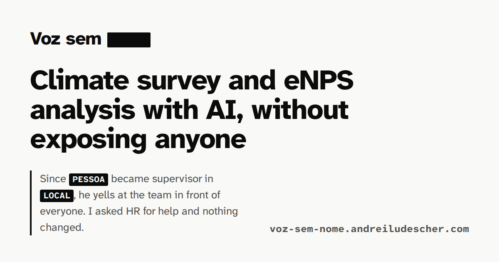
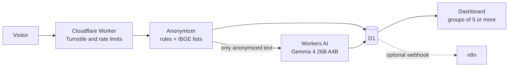

# Voz sem nome



**Climate survey and eNPS analysis with AI, built so that no name reaches the model.**

Live demo: https://voz-sem-nome.andreiludescher.com (Portuguese) · https://voz-sem-nome.andreiludescher.com/en/ (English)

Every number in this file comes from code that ran and is stored under [`metrics/`](metrics/), mostly in
[`metrics/metrics.json`](metrics/metrics.json). The one exception is the blind model panel used as a reference: its
labels were made outside this code and are stored in `data/labels/panel/`; the code recomputes the vote and the
agreement between its readings.
Numbers that were not measured yet say so.

## The problem

In a climate survey the score says little. The reasons are in the open comments, and someone has to read them one
by one: sort them by theme, notice the few that describe harassment or burnout, and keep names, phone numbers and
document numbers away from everyone who sees the results. With hundreds of answers per cycle this is slow work and a
privacy risk. Since May 2026, Brazilian companies also have to manage psychosocial risks under NR-1, and these
comments are often where such risks show up first.

## What it does

1. **Removes personal data before any analysis.** Rules for Brazilian formats (CPF, CNPJ, RG, phone, email, CEP,
   employee id, vehicle plate, street address) and official IBGE lists of first names, surnames, municipalities and
   districts replace personal data with markers such as `[PESSOA]` and `[LOCAL]`. The original text is never stored.
2. **Classifies the anonymized comment** into themes from a closed taxonomy (up to 4), the overall sentiment and a
   separate flag for critical cases: workplace bullying, sexual harassment, discrimination, burnout and mental health,
   threats or violence. The model answers in JSON constrained by a schema and validated in code.
3. **Puts recall first for critical cases.** A risk lexicon and a second, focused reading by the model catch cases the
   first reading misses. A false alarm costs minutes; a missed case costs much more.
4. **Shows results without exposing anyone.** No area, tenure band or combination with fewer than 5 answers is shown,
   and small groups are merged so that nobody can be identified by subtraction.
5. **Runs where the organization needs it.**

| | Public demo (Cloudflare) | Local mode (your own server) |
|---|---|---|
| Where it runs | a Cloudflare Worker, D1 and Workers AI; nothing on a private server | `docker compose up` on one machine, no GPU needed |
| Anonymization | rules and IBGE lists, in the Worker | the same rules and lists plus spaCy entity recognition |
| Model | Gemma 4 26B A4B on Workers AI | Gemma 4 E2B through Ollama, on CPU |
| Automations | optional webhook for critical cases | n8n: alerts, grouped digest, 30-day purge; Telegram, email and Google Forms ready but off |
| Data leaves the organization | yes, only anonymized text, to Cloudflare | no |

## Architecture



In local mode the same steps run in Docker: FastAPI, a queue worker, Ollama, SQLite and n8n, with spaCy added to the
anonymizer. The synthetic dataset on the site was analyzed in local mode.

## Results so far

Measured on a synthetic survey of 400 answers (340 with a comment) from a fictitious company. The test split has
100 comments and is never used to tune prompts or rules ([how it was measured](docs/evaluation.md)).

**Anonymization** (104 fake personal items planted at known positions in 60 comments)

| | Removed | False positives |
|---|---|---|
| Worker (demo), version edge-1.1.0 | 104 of 104 (100%, 95% CI 96.4% to 100%) | 0 |
| Local mode, version 1.1.0 | 104 of 104 (100%, 95% CI 96.4% to 100%) | 0 |

Before the IBGE place lists were added (versions 1.0.0 and edge-1.0.0) the results were 101 of 104 and 95 of 104.
Only 13 of the planted items are places, so expect lower recall on real text.

**Classification** (test split, 100 comments), against two references, neither of them human
([how they were made](docs/evaluation.md#references)):

* **Blind model panel** (main reference): a language model from a provider other than the ones the system uses read
  the blind sheet (anonymized text only, shuffled, no answers from the system) three times independently, with a
  majority vote on themes, sentiment and critical cases. The three readings agreed on 97 of 100 sentiments and 99 of
  100 critical flags (`panel_readings` in `metrics/classification.json`).
* **Generator labels**: what the synthetic data generator intended for each comment. The panel matches them on all 20
  critical cases and on 88% of sentiments (`panel_vs_intended` in the same file).

| | Public demo: Gemma 4 26B A4B on Workers AI | Local mode: Gemma 4 E2B on Ollama |
|---|---|---|
| Sentiment, panel | 89% agreement, Cohen's kappa 0.80 | 85% agreement, Cohen's kappa 0.74 |
| Sentiment, generator | 89% agreement, Cohen's kappa 0.80 | 81% agreement, Cohen's kappa 0.67 |
| Themes, panel | micro F1 0.89, macro F1 0.88 | micro F1 0.71, macro F1 0.68 |
| Themes, generator | micro F1 0.88, macro F1 0.86 | micro F1 0.70, macro F1 0.66 |
| Critical cases found (the same 20 in both references) | 20 of 20 (100%, 95% CI 84% to 100%), 1 false alarm | 19 of 20 (95%, 95% CI 76% to 99%), 2 false alarms |
| Critical cases found by the model alone / with the lexicon / with the second reading | 20 / 20 / 20 of 20, with 0 / 1 / 1 false alarms | 15 / 16 / 19 of 20, with 0 / 1 / 2 false alarms |

Human labels were not collected. The blind sheet and its guide are ready in `data/labels/`, and the evaluation uses
human labels as the main reference automatically once `data/labels/human_test.csv` exists.

Both modes use the same prompt (classify.v3), the same taxonomy, lexicon and decision rules. The second reading and
the lexicon are what bring the small local model close to the large one on critical cases; on the large model they
added one false alarm and no extra case on this split.

**Speed**

| | Result |
|---|---|
| Public demo, 100 test comments sent one at a time | median 1.2 s, p95 2.9 s, slowest 10.3 s per comment, measured inside the Worker |
| Public demo, Workers AI usage | 3,003 prompt tokens and 36 output tokens per comment on average (the second reading ran for 47% of them) |
| Local mode, 300 comments, steady state | 49.7 min in total; median 7.3 s, p95 18.7 s per comment |
| Local mode, first comment after a cold start | 57.9 s (model load and full prompt read) |
| Local mode, generation | 5.5 tokens per second |

The local server is a VM with 6 vCPUs (SSE4.2 only), 13.6 GiB of RAM and no GPU, running Ollama 0.40.16 and
gemma4:e2b-it-qat (Q4_0).

**Estimate, not a measurement:** with the measured tokens and the per model prices Cloudflare publishes, a comment
costs about 28 neurons. The Workers AI free allocation is 10,000 neurons a day, enough for about 350 comments a
day; after that the demo holds new answers until the daily reset at 00:00 UTC.

## Privacy

See [`docs/privacy.md`](docs/privacy.md): what is collected, what is never stored, who sees what, where Cloudflare
processes data (outside Brazil), retention, and a suggested legal basis under the LGPD. This is a portfolio project and
not legal advice.

## Run it

Public demo on Cloudflare: see [`docs/deploy.md`](docs/deploy.md).

Local mode, with Docker and Compose:

```sh
cp .env.example .env          # then fill the secrets, see the comments in the file
docker compose up -d          # Ollama and the model, both APIs, the queue worker and n8n
```

Pipeline on the synthetic data, from generation to the site export:

```sh
docker compose run --rm pipeline                         # live model calls, answers cached in llm_cache/
ENPS_LLM_MODE=offline docker compose run --rm pipeline   # replays llm_cache/, no model needed
```

Tests: `PYTHONPATH=src python -m pytest` (the model is mocked) and, for the Worker,
`docker run --rm -v "$PWD":/w -w /w node:24-bookworm-slim node --test worker/test/`.

## Repository

| Path | Content |
|---|---|
| `worker/` | the Cloudflare Worker: anonymizer, classifier and dashboard in JavaScript, with parity tests against Python |
| `src/enps/` | the Python side: anonymizer, classifier, queue, APIs, metrics, evaluation, synthetic data generator |
| `config/`, `prompts/` | settings, taxonomy, risk lexicon, anonymizer lists, versioned prompts |
| `data/` | the synthetic survey, the personal data gold file, the intended labels and the IBGE reference lists |
| `n8n/workflows/` | generated by `scripts/build_n8n_workflows.py`, checked for credentials by `scripts/check_n8n_export.py` |
| `site/` | the bilingual static site and dashboard |
| `metrics/` | every number shown on the site and in this file, computed by the code |

## Limitations

* The comments are synthetic, composed from a curated phrase bank, so they are more regular than real ones.
* The demo sends anonymized text to Cloudflare, outside Brazil. Organizations that cannot do that use the local mode.
* The anonymizer works with rules and lists. A name or place it does not know can pass through.
* On a CPU without AVX, local mode takes seconds per comment. A queue shows the wait.

## License

MIT. Fonts under the SIL Open Font License. The Portuguese spaCy model is CC BY-SA 4.0. Names and places from IBGE.
