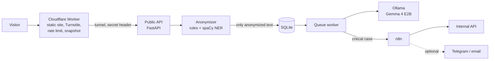

# Voz sem nome


**Climate survey and eNPS analysis with a local language model, built so that no name reaches the model.**

Live demo: https://voz-sem-nome.andreiludescher.com (Portuguese) · https://voz-sem-nome.andreiludescher.com/en/ (English)

> Status: under active development. Every number below comes from code that ran and is stored in
> [`metrics/metrics.json`](metrics/metrics.json). Numbers that were not measured yet say so.

## The problem

In a climate survey the score says little. The reasons are in the open comments, and someone has to read them one
by one: sort them by theme, notice the few that describe harassment or burnout, and keep names, phone numbers and
document numbers away from everyone who sees the results. With hundreds of answers per cycle, this is slow work and
a privacy risk.

## What it does

1. **Removes personal data first.** Rules for Brazilian formats (CPF, CNPJ, RG, phone, email, CEP, employee id,
   vehicle plate, street address), a Portuguese entity recognizer (spaCy) and a list of common first names from the
   IBGE census replace personal data with markers such as `[PESSOA]` and `[EMAIL]`. The original text is never stored.
2. **Classifies with a model that runs on the same server.** Gemma 4 E2B through Ollama, on CPU, returns themes from a
   closed taxonomy, the sentiment and a separate flag for critical cases (workplace bullying, sexual harassment,
   discrimination, burnout and mental health, threats or violence). Output is JSON constrained by a schema and
   validated with pydantic.
3. **Puts recall first for critical cases.** A risk lexicon and a second, focused reading by the model catch cases
   the first pass misses. A false alarm costs minutes; a missed case costs much more.
4. **Shows results without exposing anyone.** No area, tenure band or combination with fewer than 5 answers is shown,
   and small groups are merged so that nobody can be identified by subtraction.
5. **Automates the rest with n8n.** Alerts for critical cases, a grouped digest above an hourly limit, a daily purge
   of public submissions after 30 days. Telegram, email and Google Forms intake are ready but off by default.

## Architecture



Only the public API is reachable through the Cloudflare Tunnel, and only on five paths. n8n, Ollama, the internal
API and the database stay on the server's internal Docker network.

## Results so far

| What | Result | How it was measured |
|---|---|---|
| Personal data removed | 101 of 104 planted items (97.1%, 95% CI 91.9% to 99.0%), 0 false positives | 340 synthetic comments with fake personal data at known positions |
| Model choice | Gemma 4 E2B over Qwen3.5 2B | 40 development comments, labels from the data generator |

Performance on 300 comments and agreement with human labels are being measured.

## Privacy

See [`docs/privacy.md`](docs/privacy.md): what is collected, what is never stored, retention, who sees what, and a
suggested legal basis under the LGPD. This is a portfolio project and not legal advice.

## Run it

Requirements: Docker with Compose. Everything runs on one machine; no GPU is needed (see [`docs/gpu.md`](docs/gpu.md)).

```sh
cp .env.example .env          # then fill the secrets, see the comments in the file
docker compose up -d          # Ollama, the model download, both APIs, the worker and n8n
```

Pipeline on the synthetic data, from generation to the site export:

```sh
docker compose run --rm pipeline                      # live model calls, results cached in llm_cache/
ENPS_LLM_MODE=offline docker compose run --rm pipeline   # replays llm_cache/, no model needed
```

Tests: `PYTHONPATH=src python -m pytest` (the language model is mocked).

## Repository

| Path | Content |
|---|---|
| `src/enps/` | anonymizer, classifier, queue, APIs, metrics, evaluation, synthetic data generator |
| `config/` | settings, taxonomy, risk lexicon, anonymizer lists |
| `prompts/` | versioned prompts; every classification stores the prompt version and the model |
| `data/synthetic/` | the synthetic survey, the personal data gold file and the intended labels |
| `n8n/workflows/` | the workflows, generated by `scripts/build_n8n_workflows.py` and checked by `scripts/check_n8n_export.py` |
| `site/` | the bilingual static site and dashboard; `worker/` holds the Cloudflare Worker |
| `metrics/` | every number shown on the site and in this file |

## Limitations

* The comments are synthetic, composed from a curated phrase bank, so they are more regular than real ones.
* Three planted place names written in lower case without any cue ("moro em pirituba") were not removed.
* The model runs on a CPU without AVX, so each comment takes seconds, not milliseconds. A queue shows the wait.

## License

MIT. Fonts under the SIL Open Font License. The Portuguese spaCy model is CC BY-SA 4.0. First names from IBGE,
Censo 2022.
